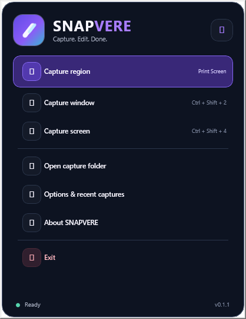
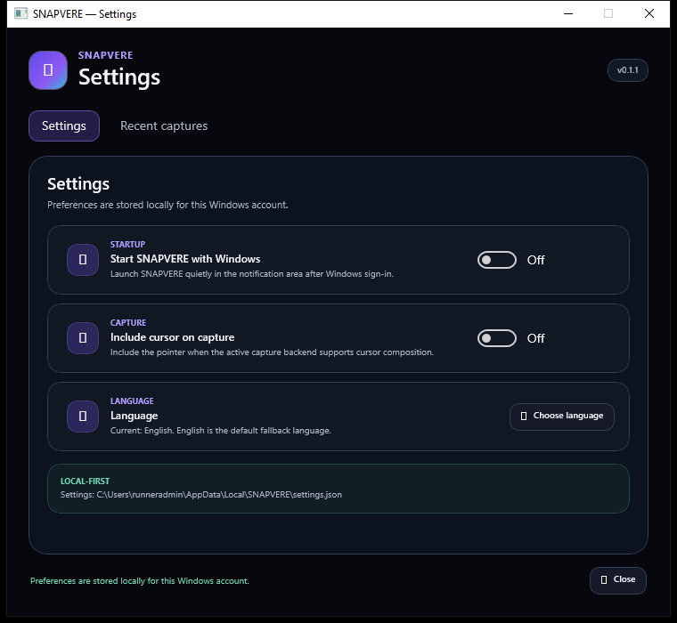
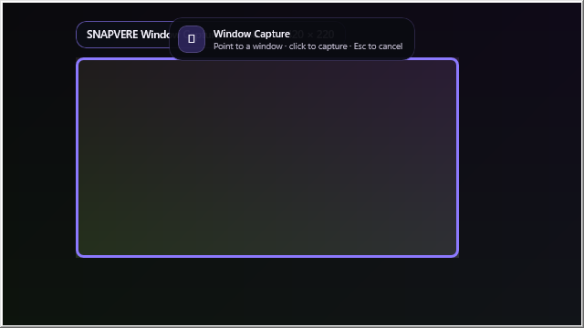

<picture>
  <source media="(prefers-color-scheme: dark)" srcset="assets/branding/readme/snapvere-logo-dark.svg">
  <source media="(prefers-color-scheme: light)" srcset="assets/branding/readme/snapvere-logo-light.svg">
  
</picture>

### Capture what matters. Keep it yours.

**Screenshots, annotations and screen recording for Windows — plus effortless web captures in Chrome, Edge, Opera and Firefox.**

Capture the moment, make your point, save it on your device. No account, no automatic cloud uploads, no ads.

[**Download SNAPVERE 0.1.36**](https://github.com/bren-wp/SNAPVERE/releases/tag/v0.1.36) · [**Explore the website**](https://snapvere.com) · [**Hrvatski**](README.hr.md)

---

## Your screen. Your workflow.

| | |
| --- | --- |
| 📸 **Capture any detail** | Choose a region, a window or a screen on Windows. Capture a visible area, selected region or bounded full page in your browser. |
| ✏️ **Mark it up** | Draw with a pen, add lines and arrows, highlight an area or frame a detail before saving your Windows region capture. |
| 🎥 **Record without distractions** | Record the primary Windows display as a local H.264 MP4, with a compact Stop button and elapsed-time indicator. Video only; audio recording isn't included. |
| ⚡ **Stay in your flow** | Work directly from the Windows system tray, use global shortcuts and revisit your latest local captures. |
| 🔒 **Private by design** | Capture processing stays on your device. No SNAPVERE account, capture analytics or automatic capture uploads. |
| 🌐 **One familiar look** | Enjoy a consistent premium dark interface in the Windows app and all four browser extensions, with English and Croatian language support. |

## See SNAPVERE in action

These are **genuine screenshots of the running Windows application**, captured from a validated Windows build — not concept renders.

<table>
  <tr>
    <td width="38%" valign="top">
      
      
<strong>Capture in a click</strong> Region, window, screen and recording controls right where you need them.

    </td>
    <td width="62%" valign="top">
      
      
<strong>Settings without clutter</strong> Your capture preferences, language, shortcuts and recent work in one place.

    </td>
  </tr>
</table>

  

<strong>Pick the right window.</strong> A clear selection overlay helps you choose exactly what to capture.

## Made for Windows

Launch SNAPVERE from the system tray; it doesn't require an always-open dashboard. Choose a capture mode using the menu or a keyboard shortcut:

| Action | Shortcut |
| --- | --- |
| **Region capture** | `Print Screen` or `Ctrl+Shift+1` |
| **Window capture** | `Ctrl+Shift+2` |
| **Screen capture** | `Ctrl+Shift+3` |
| **Screen recording** | Start and stop from the tray or Settings |

By default, finished screenshots and recordings are saved to `Pictures\SNAPVERE`. Adjust your workflow using the local Settings interface.

## Capture from your browser

SNAPVERE brings visible-area, selected-region and bounded full-page PNG capture to **Chrome, Edge, Opera and Firefox**. Files are saved locally. No browser account or SNAPVERE account is needed for captures.

The browser packages are available for manual installation; publication in a browser extension store is not implied.

## Get SNAPVERE

Choose the package that fits your workflow. The Windows Setup and Portable distributions include x86, x64 and ARM64 application payloads; the MSI package targets x64 Windows.

| Platform | Download package |
| --- | --- |
| Windows — guided installer | `SNAPVERE-Setup.exe` |
| Windows — MSI installer | `SNAPVERE-Setup.msi` |
| Windows — portable | `SNAPVERE-Portable.exe` |
| Google Chrome | `SNAPVERE-Chrome.zip` |
| Microsoft Edge | `SNAPVERE-Edge.zip` |
| Opera | `SNAPVERE-Opera.zip` |
| Mozilla Firefox | `SNAPVERE-Firefox.zip` |

**[View the SNAPVERE v0.1.36 release and downloads](https://github.com/bren-wp/SNAPVERE/releases/tag/v0.1.36)**

## Helpful links

[User guide](docs/USER-GUIDE.md) · [Installation](docs/INSTALLATION.md) · [Browser extensions](docs/BROWSER-EXTENSIONS.md) · [Privacy](docs/PRIVACY.md) · [Security](SECURITY.md) · [Troubleshooting](docs/TROUBLESHOOTING.md) · [Release history](RELEASES.md)

---

<strong>SNAPVERE</strong> by <a href="https://brendigo.com">Brendigo</a> · <a href="https://snapvere.com">snapvere.com</a> · <a href="mailto:info@snapvere.com">info@snapvere.com</a>

