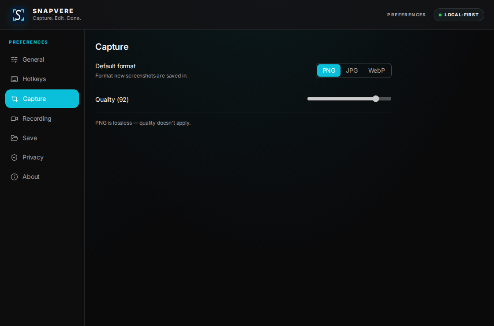
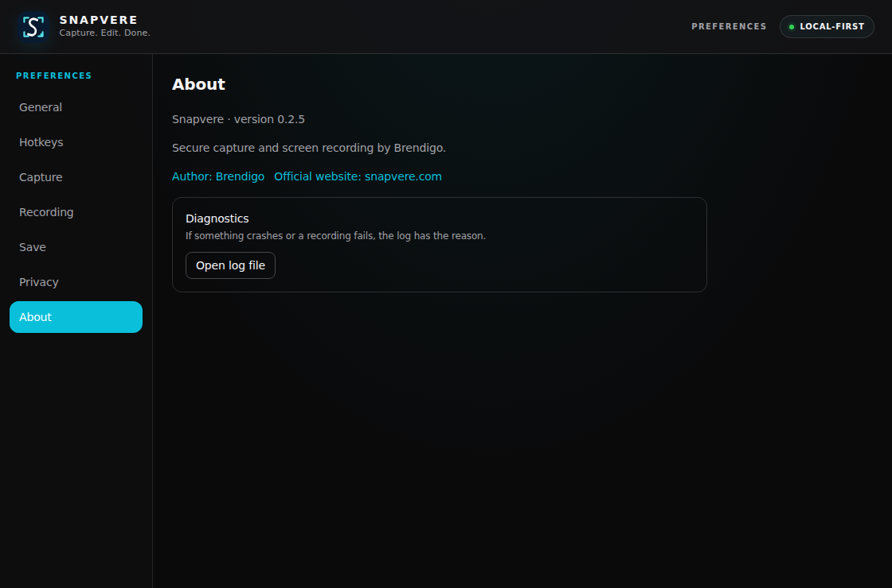
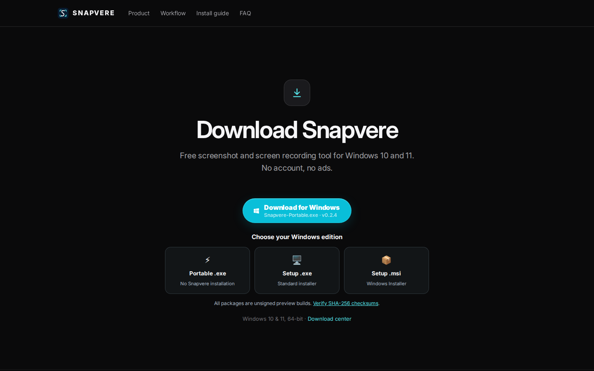
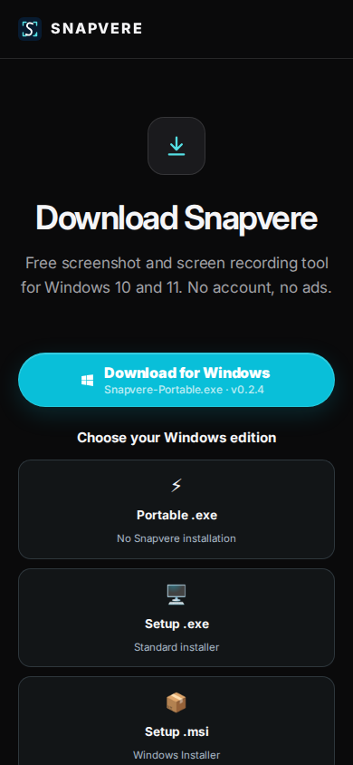
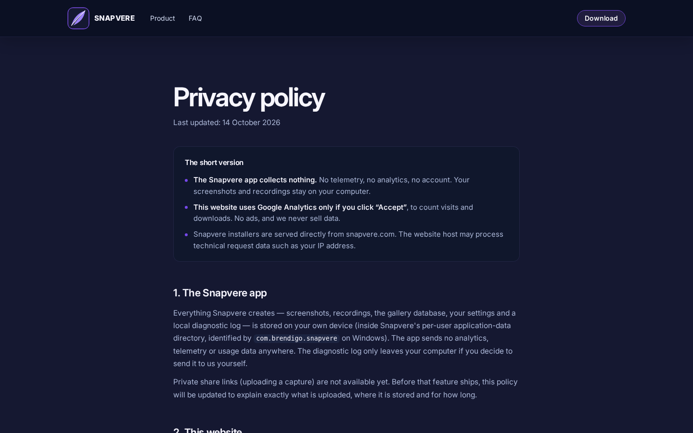
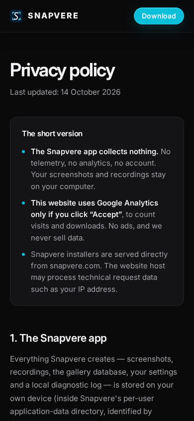

<div align="center">


# SNAPVERE

### Capture what matters. Make it clear. Keep it yours.

**Screenshot, annotate and record — without letting your tools get in the way.**

A focused Windows capture workspace from **[BRENDIGO](https://brendigo.com)**.

[](https://snapvere.com)
[](https://snapvere.com/download/)
[](https://snapvere.com/privacy/)
[](https://github.com/bren-wp/Snapvere/releases)

[**🌐 Public SNAPVERE website (.NET edition)**](https://snapvere.com/) · [**⬇️ Tauri / Rust Windows releases**](https://github.com/bren-wp/Snapvere/releases) · [**🔐 Website privacy**](https://snapvere.com/privacy/)


</div>

---

> **Distribution notice:** snapvere.com currently publishes SNAPVERE v0.0.8 built with
> .NET / WinUI 3. This repository builds the separate Tauri 2 / Rust Windows edition
> (v0.2.8). Do not mix their installers, licenses, versions or upgrade paths.
> The production website, email download flow, and its binaries are not modified
> by this GitHub release.

## Your screen. Your story. One streamlined workflow.

Capture the exact moment that matters. Add an arrow, label a detail, redact a private field, and save a result you can find again. Whether you are reporting a bug, showing a client a design, building a tutorial or documenting a process, SNAPVERE keeps the work simple.

<table>
<tr><td align="center" width="25%">📸<br/><b>Capture precisely</b><br/><sub>Choose a region or your full display</sub></td><td align="center" width="25%">✏️<br/><b>Explain visually</b><br/><sub>Draw, annotate, highlight or blur</sub></td><td align="center" width="25%">🎬<br/><b>Record the flow</b><br/><sub>MP4/GIF, cursor and optional audio</sub></td><td align="center" width="25%">🗂️<br/><b>Find it later</b><br/><sub>Search your local capture library</sub></td></tr>
</table>

### A genuine look inside SNAPVERE

The screenshots below come from **actual rendered React application screens in this repository**, captured automatically by Playwright. They are not AI mockups, and no fictitious user data, videos or recorded outcomes have been added.

<table>
<tr>
  <td width="50%"></td>
  <td width="50%"></td>
</tr>
<tr>
  <td align="center"><b>01 · Capture & organize</b><br/><sub>One home for your screenshots, recordings and quick actions</sub></td>
  <td align="center"><b>02 · Refine & explain</b><br/><sub>Annotations and copy/save commands when you need them</sub></td>
</tr>
<tr>
  <td width="50%"></td>
  <td width="50%"></td>
</tr>
<tr>
  <td align="center"><b>03 · Make it yours</b><br/><sub>Shortcuts, capture formats, audio and privacy controls</sub></td>
  <td align="center"><b>04 · See what you select</b><br/><sub>Verified on-screen frozen-frame presentation</sub></td>
</tr>
</table>

<sub>**Preview accuracy:** App UI screenshots use a simulated native Tauri bridge. The region-selection screenshot is driven by a real website-rendered image sent through the same in-memory RGBA interface as the application. These images prove which frontend UI was rendered, **not** real Windows hardware capture, recording quality, or exact pixel equivalence with the separately deployed public site.</sub>

<details>
<summary><b>🖼️ See the full interface gallery — preferences, compact layout and responsive website</b></summary>

### Workspaces


### More settings, fewer interruptions

<table>
<tr><td width="50%"></td><td width="50%"></td></tr>
<tr><td></td><td></td></tr>
<tr><td></td><td></td></tr>
</table>

### Website — desktop and mobile

<table>
<tr><td width="60%"></td><td width="40%"></td></tr>
<tr><td></td><td></td></tr>
<tr><td></td><td></td></tr>
</table>

</details>

## What's improved in v0.2.7

- **More reliable shortcuts:** Rebinding capture or recording shortcuts now preserves the previous keys if Windows rejects the new combination.
- **Cleaner full-screen captures:** The application window hides before Windows samples the display and returns afterward, reducing screenshots that accidentally contain the gallery.
- **A reliable editor:** Newly saved screenshots are explicitly authorized for the editor's image view. The preview test rejects unloaded or black editor frames.
- **Unified product identity:** The redesigned navy/violet website, app shell, feather icon, favicon, Windows executable icons, macOS icon and social preview share the same local source.
- **Clearer controls:** Accessible gallery card actions, narrower Settings layouts and status feedback for saving and changing hotkeys.

The source and interface images are built directly from the SNAPVERE project. Preview images verify rendered UI; hardware capture and recording still require device-specific validation.

## Built to stay out of your way

| | Everyday task | SNAPVERE workflow |
|---|---|---|
| 🧩 | **Report a bug clearly** | Select an area, mark the issue, copy or save the screenshot |
| 🎨 | **Review visual details** | Highlight, label and redact before handing off a screen |
| 📚 | **Create documentation** | Record an MP4/GIF walkthrough or annotate a still |
| 🔍 | **Locate past work** | Search filenames and tags in the local gallery |
| ⌨️ | **Stay in flow** | Trigger capture from the tray or a configured keyboard shortcut |
| 🛡️ | **Keep control of sensitive images** | Save captures locally, without a required cloud account |

**Local-first, by design.** Captures and gallery metadata are local. Sharing or exporting is a deliberate action. There are no in-app ads, donation prompts or mandatory user accounts for basic capture.

## Get SNAPVERE for Windows

**Windows v0.2.8 release candidate — under review in PR #18.** SNAPVERE builds three Windows package formats with SHA-256 integrity data. The latest published GitHub release remains v0.2.7 until the candidate passes its release workflow. Use the verified [GitHub Releases](https://github.com/bren-wp/Snapvere/releases) page until the public website is confirmed to mirror the new binaries. These packages remain unsigned preview builds.

| Package | Ideal for | Official download |
|---|---|---|
| 💻 **Portable EXE** | Run without installing SNAPVERE | [Snapvere-Portable.exe](https://github.com/bren-wp/Snapvere/releases/download/v0.2.7/Snapvere-Portable.exe) |
| 📦 **EXE Setup** | Guided installation | [Snapvere-Setup.exe](https://github.com/bren-wp/Snapvere/releases/download/v0.2.7/Snapvere-Setup.exe) |
| 🏢 **MSI Setup** | Windows managed installation | [Snapvere-Setup.msi](https://github.com/bren-wp/Snapvere/releases/download/v0.2.7/Snapvere-Setup.msi) |

**Requires:** 64-bit Windows 10/11 and Microsoft WebView2 Runtime. Portable means the SNAPVERE installer is not needed; some systems may still need WebView2 installed. These are **unsigned preview builds** and Windows SmartScreen may display a warning.

### Verify what you install

Download [SHA256SUMS.txt](https://github.com/bren-wp/Snapvere/releases/download/v0.2.7/SHA256SUMS.txt) **from the same package version**, then run:

```powershell
Get-FileHash .\Snapvere-Portable.exe -Algorithm SHA256
```

Compare the digest against the manifest. **Do not install files with mismatched hashes.** The website's live deployment is separate from this repository; verify that its displayed version and files match before downloading.

## Capture confidence — and current engineering work

An application should not show a black selection screen when a captured website is expected. The open development branch replaces temporary file-based image loading with memory-based RGBA transfer, a PNG fallback and clear error handling. The native packet format and visible frontend rendering have automated tests. Physical Windows verification remains required for protected content, mixed-DPI multi-monitor desktops, WebView2 variants and real recording workflows.

**Supported in this implementation:** Region screenshot capture, full-display capture, annotation tools, local gallery and screen recording.

**Not advertised as available:** Unimplemented active-window screenshot actions, private cloud upload or password-protected share links.

## For developers and reviewers

<details>
<summary><b>⚙️ Source architecture, verification and build instructions</b></summary>

**Stack:** Tauri 2, Rust, React, TypeScript, Vite, SQLite, Windows-native capture/recording integrations.

```bash
cd apps/desktop
npm ci
npm run build
npm run tauri -- build --bundles nsis,msi
```

The Windows build requires Rust/MSVC, WebView2-related build prerequisites, and Tauri packaging requirements. CI runs frontend typechecks, build and dependency audits; native Rust tests; installer builds; static website checks; branding parity; and real Chromium-generated UI previews.

```text
apps/desktop/src/               React UI: Home, Editor, Settings, capture overlay, recorder HUD
apps/desktop/src-tauri/         Rust app lifecycle, in-memory capture, recording and SQLite
site/                           SNAPVERE product, download and privacy website
docs/screenshots/               Automated real interface and responsive-site renders
tools/                          Screenshot, brand, capture-pipeline and site checks
.github/workflows/              CI, preview, dependency refresh and release workflows
```

**Dependency policy:** Use lockfiles for reproducible installs and test compatible updates before merging. Major framework upgrades that change generated CSS, runtime behavior or APIs must pass visual and native regression testing — never update versions just to make numbers look newer.

**License and attribution:** SNAPVERE/BRENDIGO is the product/publisher identity. Third-party dependencies and derived source remain subject to their legal notices; a brand refresh does not erase those obligations.

</details>

---

<div align="center">

### Make every capture count.

[**Discover SNAPVERE**](https://snapvere.com/) · [**Download for Windows**](https://snapvere.com/download/)

**SNAPVERE** · A product of **BRENDIGO**  
[🌐 snapvere.com](https://snapvere.com/) · [🏢 brendigo.com](https://brendigo.com/)

</div>
