<div align="center">


# SNAPVERE

### Capture what matters. Edit it instantly. Keep it local.

**A Windows screenshot and screen recording workspace by [BRENDIGO](https://brendigo.com).**

[🌐 Official website](https://snapvere.com/) · [⬇️ Download](https://snapvere.com/download/) · [🔒 Privacy](https://snapvere.com/privacy/)

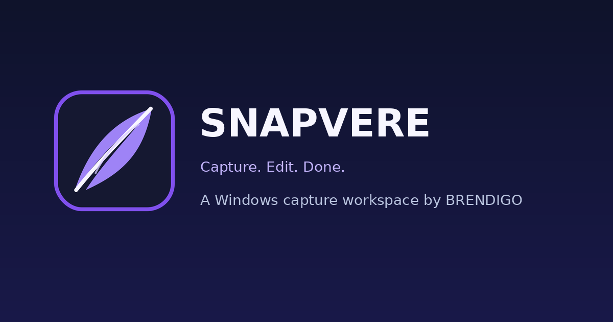

</div>

---

## Your screenshots, under your control

Select a portion of your desktop, capture the entire screen, or record a walkthrough. Annotate what matters, obscure private information, and manage the result in a local gallery. **No account required to capture.**

| 📸 Capture | 🎬 Record | ✏️ Annotate | 🗂️ Organize |
|:--:|:--:|:--:|:--:|
| Screen area or full screen | MP4 / GIF | Arrows, shapes, text, blur | Searchable local gallery |
| Multi-monitor support | Optional audio and cursor | Copy, export and save | Local SQLite metadata |

## See the real interface

These are **actual browser renders of the project's React/Tauri frontend**, created from the source by an automated Playwright workflow. The workflow stubs the native IPC layer for previews; **the images do not themselves verify the Windows capture or recording engine**. No AI-generated app screenshots are used.

<table>
  <tr>
    <td width="50%">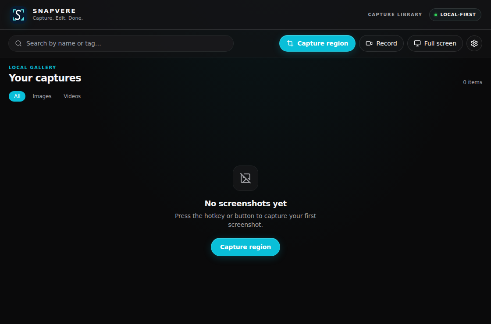</td>
    <td width="50%">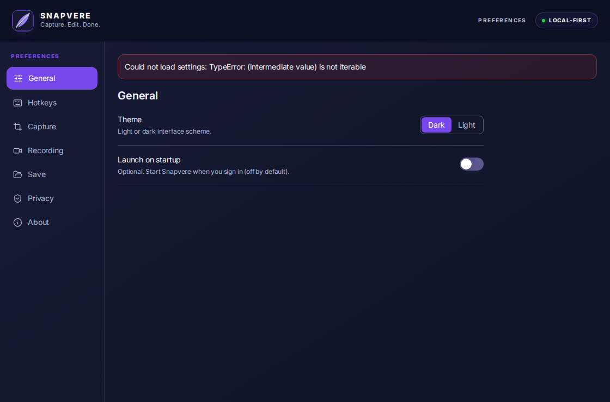</td>
  </tr>
  <tr>
    <td align="center"><strong>Capture library</strong><br />Fast shortcuts, search and capture history</td>
    <td align="center"><strong>Preferences</strong><br />Appearance, hotkeys, output and privacy</td>
  </tr>
</table>

<details>
  <summary><strong>🖥️ More app and website previews</strong></summary>

  **Compact desktop layout**

  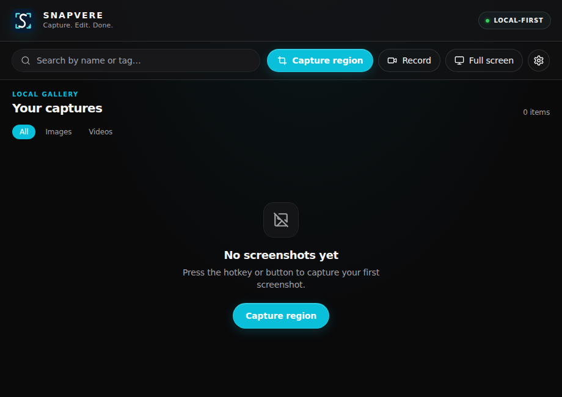

  **Region selection overlay — verified in-memory framebuffer render**

  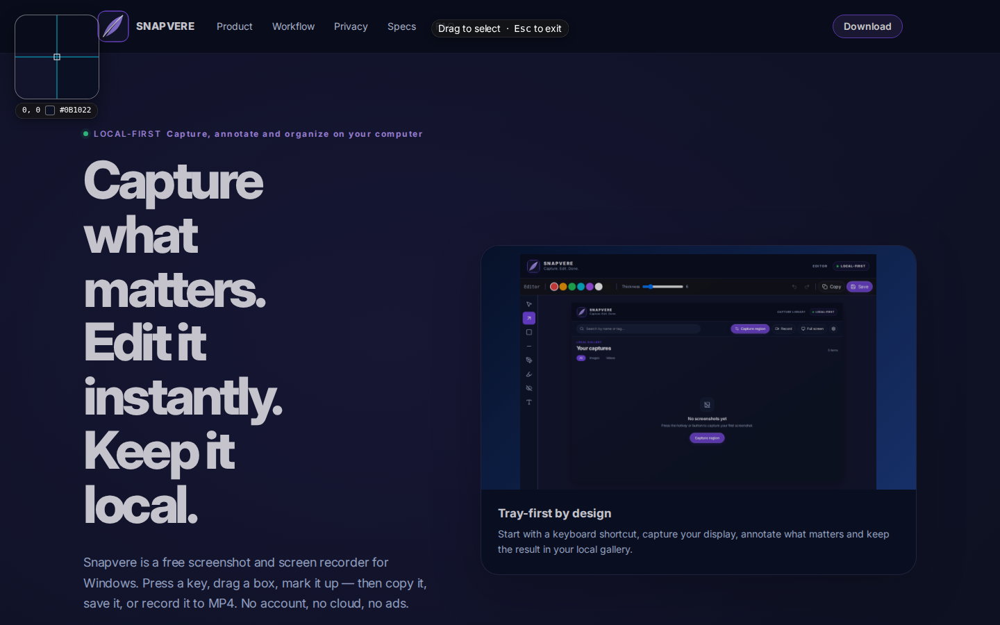

  This frame is sourced from a real render of the SNAPVERE website and passed through the preview's simulated native event and RGBA IPC format. The automated test asserts non-black pixels; real Windows capture is tested separately.

  **Screenshot editor — annotation controls and a real interface screenshot**

  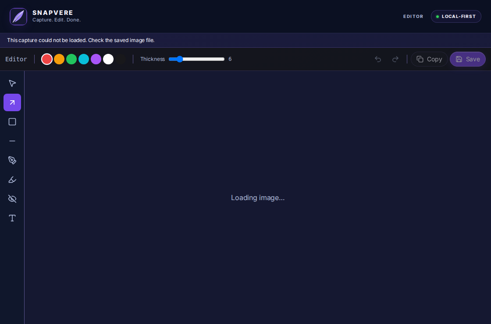

  **Recording, capture, hotkey, save, privacy and about settings**

  <table><tr><td>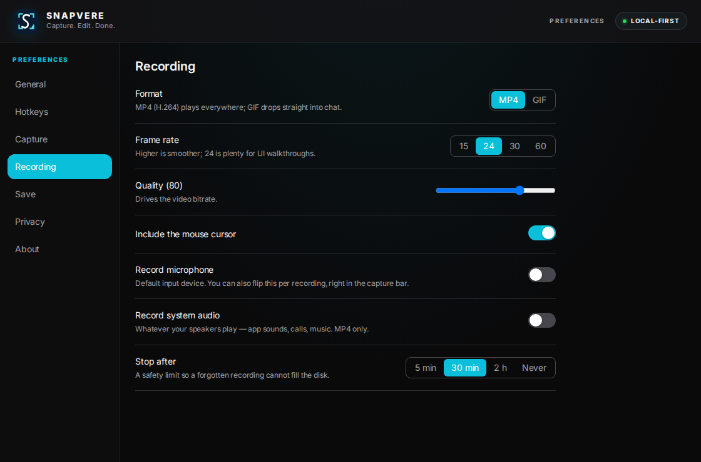</td><td>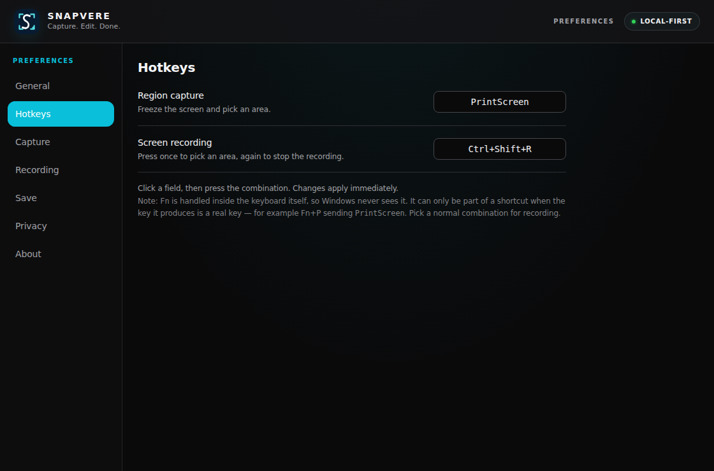</td></tr><tr><td>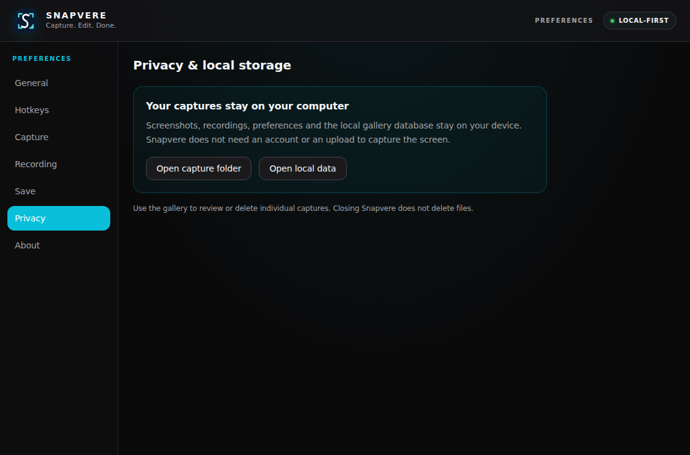</td><td>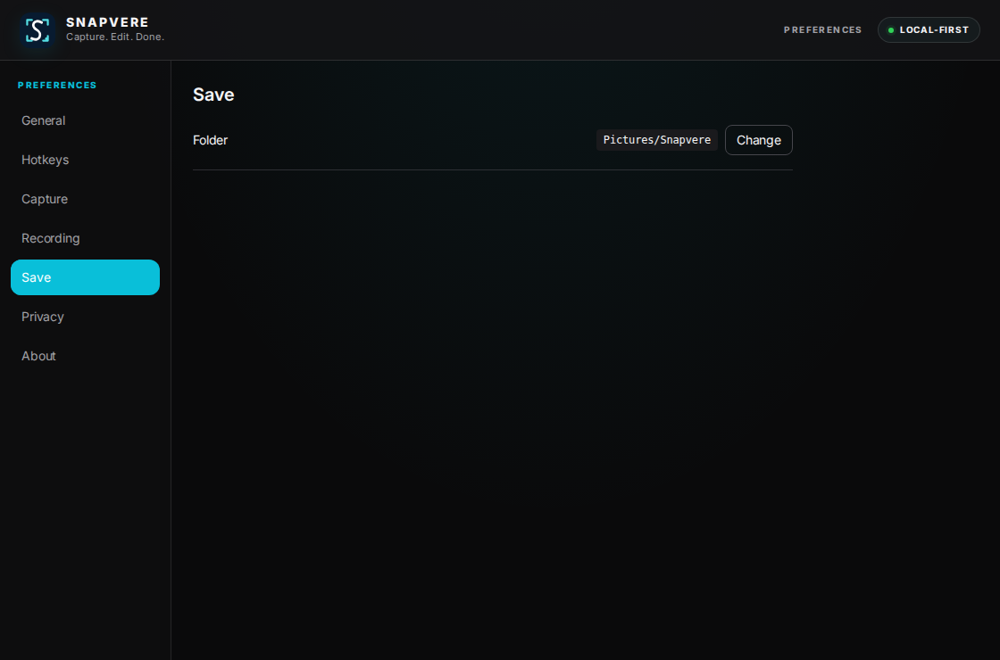</td></tr></table>

  **Official website — desktop**

  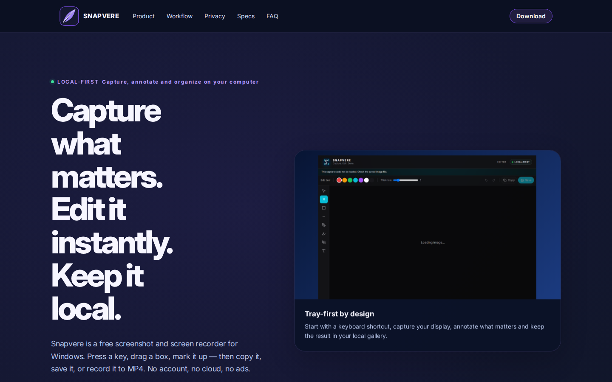

  **Official website — mobile**

  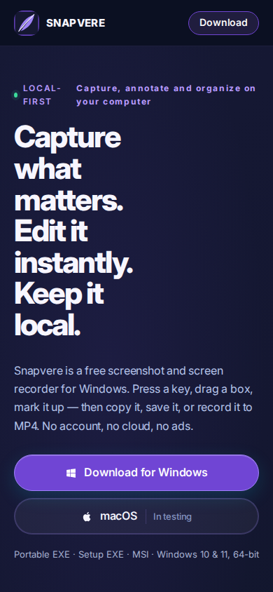
</details>

## Download for Windows

**Latest published build: v0.2.5.** Portable executable, EXE installer and MSI package are built from the same Windows release. Development changes in PRs are not automatically part of the published version.

| Edition | What you get | Download |
|---|---|---|
| 💻 **Portable EXE** | Run without a Snapvere installer | [Snapvere-Portable.exe](https://snapvere.com/files/Snapvere-Portable.exe) |
| 📦 **Setup EXE** | Windows installer | [Snapvere-Setup.exe](https://snapvere.com/files/Snapvere-Setup.exe) |
| 🛠️ **MSI** | Managed Windows installation | [Snapvere-Setup.msi](https://snapvere.com/files/Snapvere-Setup.msi) |

**System requirements:** 64-bit Windows 10 or 11 and Microsoft WebView2 Runtime. Portable mode does not automatically bundle every system prerequisite. The available binaries are unsigned preview builds: Windows SmartScreen may display a warning.

**Integrity:** Download [SHA256SUMS.txt](https://snapvere.com/files/SHA256SUMS.txt) alongside the installers. Verify the SHA-256 checksum for the exact file and version you downloaded:

```powershell
Get-FileHash .\Snapvere-Portable.exe -Algorithm SHA256
```

The website deployment and its download mirror are separate from the repository. Check the published version before installing; a new commit does not mean the live website has been deployed.

## Core workflow

**01 — Capture.** Launch from the system tray, use the configured screenshot hotkey, or select a capture action in the gallery.

**02 — Focus.** Drag to select a region. The app displays the captured desktop image behind the selection; tools let you annotate and redact sensitive content.

**03 — Save.** Copy the result to the clipboard, save it as an image, or open it in the editor.

**04 — Revisit.** Search the local capture library, open a recording, or reveal the exported file in Explorer.

The project includes capture region and full-screen actions. **Active-window capture and private cloud upload are not presented as implemented features.**

## Privacy and security

Capture files and metadata are stored locally; screenshot capture does not require an account. The desktop application does not display donation advertisements or public promotional links. Screen content is sensitive: review it before copying, exporting or sharing it.

A blocked image source must never be silently presented as a successful black screenshot. The development branch includes an in-memory framebuffer transfer with a PNG fallback and an explicit failure path to address that issue.

## Build from source

**Stack:** Tauri 2, Rust, React, TypeScript, Vite, SQLite.

```bash
cd apps/desktop
npm ci
npm run build
npm run tauri -- build --bundles nsis,msi
```

Windows packaging requires Rust/MSVC and Tauri's native Windows build prerequisites. The project's CI runs frontend checks, dependency auditing, native Rust tests and Windows packaging. UI preview rendering uses the scripted browser under `tools/capture_ui.py`.

```text
apps/desktop/src/                Windows UI (gallery, settings, overlay, editor and recorder HUD)
apps/desktop/src-tauri/          Native capture, recording, storage and app lifecycle
site/                            SNAPVERE website, download and privacy pages
docs/screenshots/                Real rendered UI and website previews
tools/                           Automated site, branding and screenshot checks
.github/workflows/               Build, visual QA and Windows release workflows
```

## Product identity

**SNAPVERE** is the product name. **BRENDIGO** is the product publisher and maintainer. Official domain: **[snapvere.com](https://snapvere.com)** · Publisher: **[brendigo.com](https://brendigo.com)**.

The application and website share the same SNAPVERE design tokens and wordmark. Development source derived from third-party components remains subject to applicable licence and attribution obligations; product rebranding does not remove those obligations.

---

<div align="center">

**SNAPVERE** · by **BRENDIGO**  
[🌐 snapvere.com](https://snapvere.com) · [🏢 brendigo.com](https://brendigo.com)

</div>
